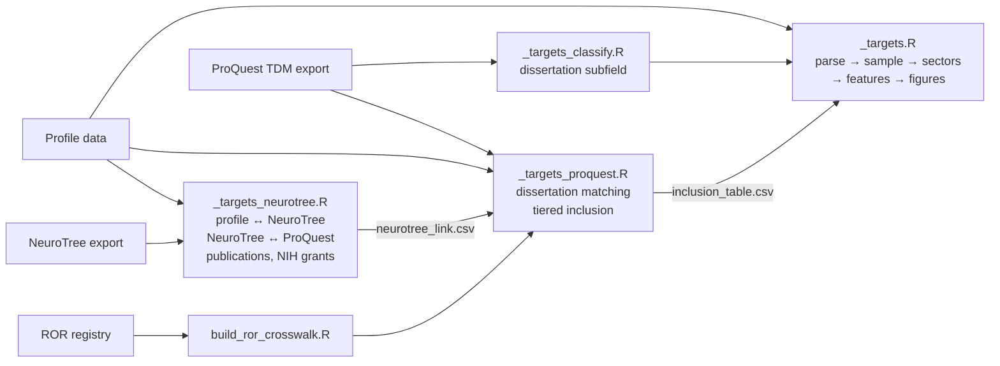

# Neuroscience PhD Career Outcomes

Where do people with a PhD in neuroscience end up working, and how has that
changed across graduating cohorts? This repository contains the data pipeline
for a study that answers that question by linking public professional profiles
to dissertation records and academic genealogy data.

> **Status: preliminary.** The pipeline is under active development and no
> results are reported here yet. This repository contains code and methods
> documentation only. It contains no data. See [Data availability](#data-availability).

## Approach

Most of what is known about neuroscience PhD careers comes from surveys
(NSF's Survey of Doctorate Recipients, institutional exit surveys). Surveys are
reliable but coarse: they report a handful of sectors, at long intervals, with
little detail about career paths. Public professional profiles offer the
opposite trade-off. They contain detailed job histories, but they are
self-reported, unevenly complete, and say nothing reliable about *what* a
person's PhD was in.

This project gets around the second problem by requiring outside
confirmation. A person is counted only if:

1. there is positive evidence that their doctorate was in neuroscience, and
2. their dissertation can be found in the ProQuest Dissertations & Theses
   corpus.

Both identity and field are therefore checked against a source independent of
the profile. Roughly 95,000 profiles were screened; the verified analytic
sample is about 8,000 people. Career histories are then classified into
sectors (academia, government, industry, other) and finer subsectors, and
analyzed by PhD cohort.

The full reasoning behind every definition is in [METHODS.md](METHODS.md).

## Pipeline

The pipeline is written in R using [`targets`](https://docs.ropensci.org/targets/).
It is split into four stores, so that an expensive linkage step never forces
the rest of the pipeline to rebuild.



Stores communicate through small CSV "seams" written to `output/tables/`, so
each can be run and inspected independently. Run them in order:

```r
targets::tar_make(script = "_targets_neurotree.R", store = "_targets_neurotree")
targets::tar_make(script = "_targets_proquest.R",  store = "_targets_proquest")
targets::tar_make()   # core pipeline
```

### Code layout

| Path | Contents |
|---|---|
| `R/01_parse.R` | Profile parsing: education and experience arrays, date handling |
| `R/02_filter.R`, `R/12_inclusion.R` | Neuroscience detection and tiered inclusion |
| `R/03_features.R` | Person-level features: PhD year, first and current position |
| `R/04_link.R`, `R/sector_map.R`, `R/22_ucot.R` | Employer linkage and sector classification |
| `R/07_proquest.R` | Name and institution matching against dissertation records |
| `R/18_neurotree.R`, `R/23_pubs.R`, `R/24_grants.R` | NeuroTree linkage, publication counts, NIH funding |
| `R/20_ror.R` | Institution resolution against the Research Organization Registry |
| `R/22_rankings.R` | Program-ranking covariate |
| `R/08_classify.R` | Dissertation subfield classification |
| `R/05_plots.R`, `R/06_figure_settings.R` | Figures and shared figure settings |
| `R/00_qc.R` | Data-quality checks |
| `dev_figs.R` | Redraws figures from a built store without rerunning the pipeline |

## Data availability

None of the input data is included. Profile data and the ProQuest export are
licensed and cannot be redistributed, and the profile data concerns
identifiable individuals. NeuroTree and ROR data are openly licensed but large;
`data/fetch_neurotree.R` and `data/fetch_ror.R` download them.

The pipeline therefore will not run as-is. [DATA_SOURCES.md](DATA_SOURCES.md)
lists every input, its license, and the path the code expects it at. The
scripts used to acquire profile data are not part of this repository; the
methods document describes that step.

When results are published, they will be reported only as aggregates, with
small cells suppressed. No individual will be named or identifiable.

## Requirements

R ≥ 4.3 with tidyverse, targets, tarchetypes, jsonlite, lubridate, stringdist,
fuzzyjoin, stringi, data.table, fs, cowplot, showtext, ragg and zoo. The
optional LLM classification step also uses httr2.

## License

Code: MIT (see [LICENSE](LICENSE)). Documentation: CC BY 4.0.

Findings that use NeuroTree-derived data must credit academictree.org and cite
[10.1038/s41467-018-07034-y](https://doi.org/10.1038/s41467-018-07034-y) or
the dataset DOI [10.5281/zenodo.4247418](https://doi.org/10.5281/zenodo.4247418);
see [DATA_SOURCES.md](DATA_SOURCES.md).
